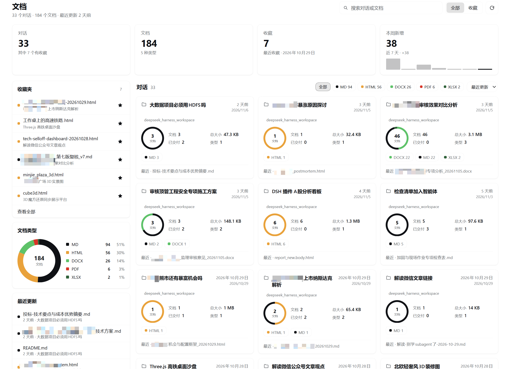
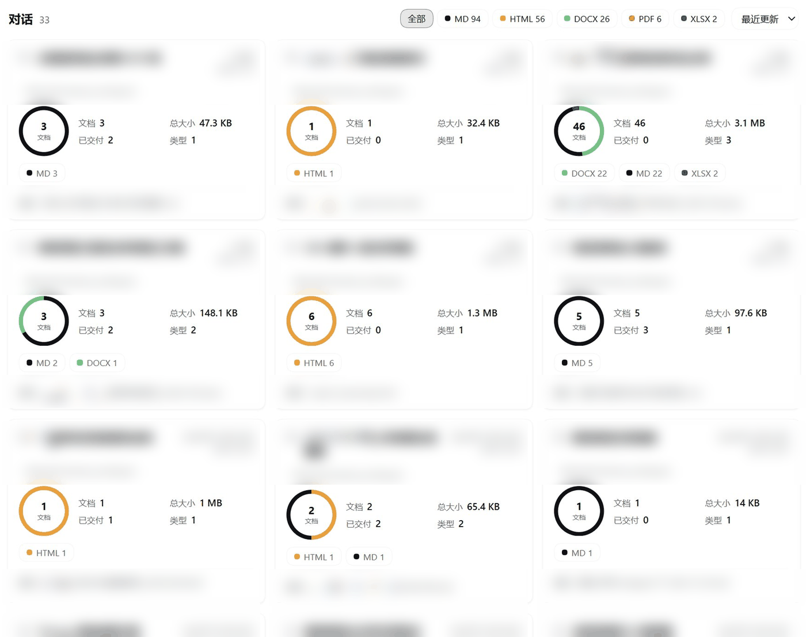
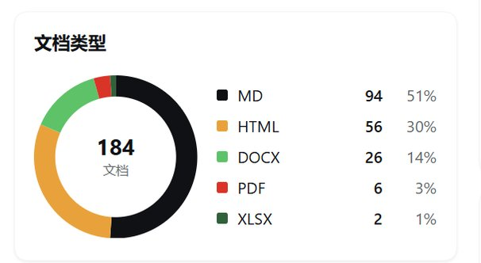

# dsh-doc-panel

A conversation-scoped document browser for **DeepSeek Harness**: every document your
conversations produce — organized by the conversation that produced it, searchable and
previewable, without leaving the app.

[](LICENSE)


**English** · [简体中文](README.zh.md)



## Why

Agent conversations produce real deliverables: Markdown reports, single-file HTML
dashboards, PDFs, spreadsheets, Word documents. They pile up in one workspace (or a few),
and there is no built-in place to see what a particular conversation created, find last
week's report, or keep the files you care about within reach.

dsh-doc-panel adds one **Documents** panel to the Harness sidebar. It indexes the
documents each conversation produced, groups them under that conversation, and gives you
the same three things a file manager gives you: a place to browse, a way to search, and
a short list of favorites.

## Features

- **Conversation folders** — one card per conversation showing its summary outside the
  folder: document count, total size, relative update time and type mix.
- **Dashboard overview** — KPI tiles for conversations, documents, favorites and the
  last seven days (with a small bar sparkline), a document-type donut, and a
  recently-updated list.
- **Instant search** — filters conversation titles, document names and paths as you
  type. It is client-side; document *contents* are not indexed or searched.
- **Favorites** — star a document from any list or from the preview header. Favorites
  persist to disk and survive restarts; files that disappeared stay listed as
  unavailable and cannot be opened.
- **Inline previews** — rendered Markdown, sandboxed HTML pages, embedded PDF, plain
  text/source view, and open/download cards for Office documents. Markdown and HTML have
  an explicit preview/source toggle.
- **Accurate grouping** — documents are discovered from session-log references
  (`write`, `edit`, `present`, write-capable tool arguments) plus a filtered workspace
  scan. Subagent sessions are folded into their root conversation.
- **Native look** — styled only with Harness theme tokens, so light and dark themes both
  work and the panel sits naturally beside the other Harness pages. Charts are pure
  SVG/CSS; no chart library.
- **Quiet by design** — no network requests, no telemetry, no runtime dependencies, no
  build step. The Host half uses Node builtins only.
- **Bilingual UI** — English and Simplified Chinese, following the Harness locale.

## Install

Prerequisites: a DSH installation with the `plugin_manager` tool. Tested on DSH Desktop
`0.2.2-rc.1` with Node 24; Node.js 22+ in general. `plugin_manager` actions may require
Full access or an approval prompt.

### Option 1 — local checkout (recommended)

```bash
git clone https://github.com/leobasic/dsh-doc-panel.git
```

Then install the bundle from its absolute path:

```js
plugin_manager({ action: 'install_bundle', target: '/absolute/path/to/dsh-doc-panel' })
```

No build step is involved — the files are used as written. Uninstall with
`plugin_manager({ action: 'remove_bundle', target: 'dsh-doc-panel' })`.

### Option 2 — directly from GitHub

If your DSH build supports installing from a git spec:

```js
plugin_manager({ action: 'install_bundle', target: 'https://github.com/leobasic/dsh-doc-panel' })
```

Otherwise use Option 1 and point `target` at the checkout directory.

### Option 3 — npm

Once the package is published to npm, install it by package name:

```js
plugin_manager({ action: 'install_bundle', target: 'dsh-doc-panel' })
```

The npm package contains only the Harness bundle files; DSH is still required to run it.

## Usage

1. Click the **documents icon** in the left sidebar.
2. The dashboard opens on the conversations that produced documents. Click a
   conversation card to open its folder.
3. Click a document to preview it. Markdown renders as formatted content, HTML renders
   in a sandboxed frame, PDF embeds, Office files offer open/download. Use
   预览 / 源码 to switch between rendered and source.
4. Click the star on any document (or in the preview header) to favorite it; the
   收藏 segmented control and the 收藏夹 card list favorites. Search filters everything
   and the refresh button reindexes.

The very first scan reads the session corpus and can take a little while; later loads
use the cache and are fast.

## Configuration

The plugin row accepts an optional `config` object. All keys are optional.

| Key | Default | Purpose |
|---|---|---|
| `extensions` | `.md .markdown .html .htm .pdf .docx .doc .xlsx .xls .pptx .ppt` | Document types listed, scanned and previewed. `.csv`/`.txt` are opt-in: add them here if you want them. |
| `maxFiles` | `5000` | Total cap on files collected per scan. |
| `maxDepth` | `6` | Maximum directory depth walked below each conversation workspace. |
| `cacheTtlMs` | `60000` | How long the in-memory/persisted index is considered fresh. |
| `cachePath` | `null` | Index cache override. `null` = `<defaultDirectory>/.dsh-doc-panel/index.json`. |
| `favoritesPath` | `null` | Favorites store override. `null` = `<defaultDirectory>/.dsh-doc-panel/favorites.json`. |
| `timeoutMs` | `180000` | Hard deadline for one scan; on expiry a partial index is returned with `diag.complete: false`. |
| `warmOnStartup` | `true` | Warm the index in the background shortly after activation. |

```yaml
- id: dsh-doc-panel
  name: dsh-doc-panel
  config:
    extensions: ['.md', '.markdown', '.html', '.htm', '.pdf', '.docx', '.doc', '.xlsx', '.xls', '.pptx', '.ppt']
    maxFiles: 5000
    maxDepth: 6
    cacheTtlMs: 60000
    cachePath: null       # null = <defaultDirectory>/.dsh-doc-panel/index.json
    favoritesPath: null   # null = <defaultDirectory>/.dsh-doc-panel/favorites.json
    timeoutMs: 180000
    warmOnStartup: true
```

`<defaultDirectory>` is the Harness default working directory (the profile directory on
a normal install; `~/.dsh` as a fallback). Full reference and file formats:
[docs/configuration.md](docs/configuration.md).

## How it works

The plugin has a Host half (`index.js`, Node) and a Client half (`client.js`, React in the
Harness Web app), wired by `cordis.patch.yml` — no build step, no bundler.

- The Host reads the session corpus through the `sessionQuery` service and reduces each
  session log to compact signals: title, first/last time, turn windows and document path
  references.
- It scans each conversation's workspace for files matching the configured extensions
  (skipping harness internals such as `node_modules`, `.git`, `.asar` trees, dot
  directories and scratch files).
- Every file is attributed by a four-tier rule: explicit reference → reference path
  mentioned by a write-capable tool → turn time window around the file's mtime → whole
  session window. Files that cannot be attributed are not listed.
- Child/subagent sessions fold into their root conversation, so a delegated agent's
  documents appear under the conversation that spawned it.
- The resulting index is cached in memory, persisted atomically as JSON, and warmed on
  startup; `POST api/dsh-doc-panel/list` serves it, while `read`/`file` serve previews
  from an allow-listed set of indexed paths.
- The Client registers one sidebar entry and one main panel, renders the dashboard and
  previews, and runs HTML previews in a `sandbox="allow-scripts allow-downloads"` iframe
  (no same-origin access).

Details and the data-flow diagram: [docs/architecture.md](docs/architecture.md).

## Privacy & security

- **No network, no telemetry.** The plugin makes no outbound requests and embeds no
  analytics, crash reporting or update checks. Your browser only talks to your own
  Harness server over the existing authenticated session.
- **Reads stay local.** It reads session history through Harness services and workspace
  file metadata matching your extension list; file contents are read only when you
  preview a document.
- **Writes are minimal.** Only two files: an index cache and a favorites store, both
  under `<defaultDirectory>/.dsh-doc-panel/` (both overridable, both safe to delete).
- **Preview routes are allow-listed.** `read` and `file` only serve paths present in the
  current index; they cannot be used to read arbitrary files.
- **HTML is sandboxed.** HTML previews run with `allow-scripts` but without
  `allow-same-origin`, so a document cannot touch the Harness DOM, cookies, storage or
  authenticated API. Scripts inside a previewed HTML file can still make their own
  network requests under normal browser rules — preview only documents you trust.

Full threat model and the exact read/write surfaces: [docs/privacy.md](docs/privacy.md).

## Screenshots

The hero above is the full dashboard: KPI tiles, the favorites card, the document-type
donut and the conversation folders. Below: the conversation card grid and the
document-type breakdown. Conversation titles, workspace names and file names in the card
grid are intentionally blurred — the screenshots come from a real library and are
redacted before publication.

| Conversation card grid | Document types |
|---|---|
|  |  |

## Development

The repository is a DSH plugin bundle: plain ESM, no build step, no runtime dependencies.
`index.js` is the Host half, `client.js` the Web half, `cordis.patch.yml` wires the plugin
row.

```bash
node --check index.js      # Host syntax
node --check client.js     # client syntax
node scripts/test-all.mjs  # all test suites + static checks
```

Tests run fully offline against synthetic fixtures and do not need a running Harness.
Developer-only real-corpus helpers, when present locally, are excluded from the
published package and are not required for development. Layout, test descriptions,
adding a document kind and debugging tips: [docs/development.md](docs/development.md).

## Limitations

- The Markdown renderer is intentionally a pragmatic subset: no setext headings, no
  reference-style links, and raw inline HTML is displayed as text (never executed).
- Relative assets referenced from Markdown are not served; images resolve through the
  raw-file route only for absolute paths (or `http(s)`/`data:` URLs).
- HTML previews run in a sandboxed frame without same-origin access, so pages that depend
  on same-origin storage or APIs can misbehave.
- Documents must still exist on disk: deleted or moved files drop out of the index, and
  a preview requires the file to be readable.
- Attribution is heuristic. A file copied in from outside the session, or renamed/edited
  long after the turn that created it, can be assigned to the wrong conversation — or not
  listed at all.
- Legacy v0 session logs may be unreadable by the current Harness; those scans return a
  partial index with `diag.complete: false`.
- `.csv` and `.txt` are not indexed by default (they are usually intermediate files); add
  them through `extensions` if you want them.

## License

MIT — Copyright (c) 2026 leobasic. See [LICENSE](LICENSE).

dsh-doc-panel is an unofficial community plugin. It is not affiliated with, or endorsed
by, DeepSeek.
