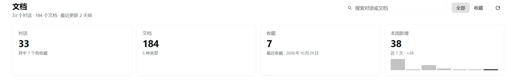
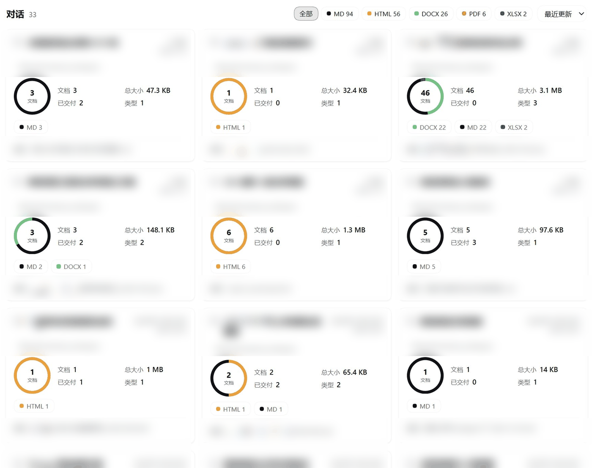
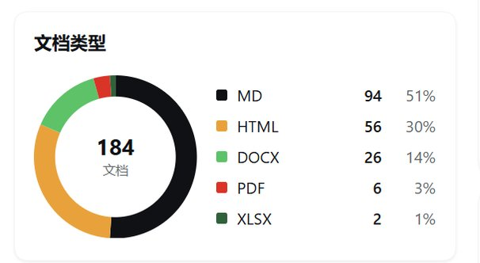

# dsh-doc-panel

一个面向 **DeepSeek Harness** 的对话文档浏览器：每个对话产出的文档，按对话归档，
可检索、可预览，不用离开应用。

[](LICENSE)


[English](README.md) · **简体中文**



## 为什么需要它

对话式 Agent 会产出真正的交付物：Markdown 报告、单文件 HTML 看板、PDF、表格、Word
文档。它们散落在一个（或几个）工作目录里，而应用内没有一个地方能一眼看到某个对话
产出了什么、找到上周的报告，或者把常用的文件留在手边。

dsh-doc-panel 在 Harness 侧栏增加一个 **文档** 面板：把每个对话产出的文档建立索引，
按对话归组，并提供文件管理器最实用的三件事——浏览、搜索、收藏。

## 功能

- **对话文件夹** —— 每个对话一张卡片，在卡片外面就能看到摘要：文档数、总大小、
  相对更新时间与类型构成。
- **仪表盘概览** —— 对话数、文档数、收藏数、近七天新增四个指标卡片（含条形
  sparkline），文档类型环图，以及最近更新列表。
- **即时搜索** —— 输入时即筛选对话标题、文档名与路径。搜索在客户端完成，
  不索引、不检索文档正文。
- **收藏** —— 在任意列表或预览头部点击星标即可收藏；收藏会落盘，重启后仍在。
  文件已不存在的收藏会标注为不可用，并且无法打开。
- **内嵌预览** —— Markdown 渲染、沙箱化 HTML 页面、内嵌 PDF、纯文本/源码视图，
  Office 文档提供打开/下载卡片。Markdown 与 HTML 还提供预览/源码切换。
- **归组准确** —— 文档来自会话日志中的引用（`write`、`edit`、`present`、具备写能力的
  工具参数），再加一次带过滤的工作区扫描；子会话（subagent）的产物归入其根对话。
- **原生观感** —— 只使用 Harness 主题 token，自动适配明暗主题，与其它页面风格一致。
  图表为纯 SVG/CSS 实现，不引入图表库。
- **安静** —— 不发网络请求、无遥测、无运行时依赖、无需构建。Host 端只使用 Node 内置模块。
- **双语界面** —— 简体中文与英文，跟随 Harness 语言设置。

## 安装

前置条件：已安装 DSH，并可使用 `plugin_manager` 工具。已在 DSH Desktop
`0.2.2-rc.1`（Node 24）上验证；一般要求 Node.js 22+。`plugin_manager` 操作可能需要
Full access 或审批。

### 方式一 —— 本地克隆（推荐）

```bash
git clone https://github.com/leobasic/dsh-doc-panel.git
```

然后用绝对路径安装 bundle：

```js
plugin_manager({ action: 'install_bundle', target: '/absolute/path/to/dsh-doc-panel' })
```

不需要构建，代码按原样加载。卸载：
`plugin_manager({ action: 'remove_bundle', target: 'dsh-doc-panel' })`。

### 方式二 —— 直接从 GitHub 安装

如果你的 DSH 版本支持从 git spec 安装：

```js
plugin_manager({ action: 'install_bundle', target: 'https://github.com/leobasic/dsh-doc-panel' })
```

否则请使用方式一，把 `target` 指向克隆目录。

### 方式三 —— npm

npm 包发布后，可按包名安装：

```js
plugin_manager({ action: 'install_bundle', target: 'dsh-doc-panel' })
```

npm 包只包含 Harness bundle 文件；运行仍需 DSH。

## 使用

1. 点击左侧栏的 **文档图标**。
2. 仪表盘会列出产出过文档的对话；点击对话卡片进入该文件夹。
3. 点击文档即可预览：Markdown 渲染为排版内容，HTML 在沙箱中渲染，PDF 内嵌显示，
   Office 文档提供打开/下载。用 预览 / 源码 切换渲染与源码。
4. 在任意文档上（或预览头部）点击星标即可收藏；顶部的 收藏 切换与 收藏夹 卡片
   会列出收藏。搜索会过滤全部内容，刷新按钮会重新建立索引。

首次扫描需要读取会话语料，可能稍慢；之后走缓存，速度很快。

## 配置

插件行可传入可选的 `config` 对象，所有键均为可选。

| 键 | 默认值 | 说明 |
|---|---|---|
| `extensions` | `.md .markdown .html .htm .pdf .docx .doc .xlsx .xls .pptx .ppt` | 列出、扫描与预览的文档类型。`.csv`/`.txt` 默认关闭，需要时自行加入。 |
| `maxFiles` | `5000` | 单次扫描收集文件的总上限。 |
| `maxDepth` | `6` | 每个对话工作区向下遍历的最大目录深度。 |
| `cacheTtlMs` | `60000` | 内存/持久化索引被视为新鲜的时间。 |
| `cachePath` | `null` | 索引缓存路径。`null` = `<defaultDirectory>/.dsh-doc-panel/index.json`。 |
| `favoritesPath` | `null` | 收藏存储路径。`null` = `<defaultDirectory>/.dsh-doc-panel/favorites.json`。 |
| `timeoutMs` | `180000` | 单次扫描的硬超时；超时返回部分索引，并带 `diag.complete: false`。 |
| `warmOnStartup` | `true` | 启用后，插件加载后会在后台预热索引。 |

```yaml
- id: dsh-doc-panel
  name: dsh-doc-panel
  config:
    extensions: ['.md', '.markdown', '.html', '.htm', '.pdf', '.docx', '.doc', '.xlsx', '.xls', '.pptx', '.ppt']
    maxFiles: 5000
    maxDepth: 6
    cacheTtlMs: 60000
    cachePath: null       # null = <defaultDirectory>/.dsh-doc-panel/index.json
    favoritesPath: null   # null = <defaultDirectory>/.dsh-doc-panel/favorites.json
    timeoutMs: 180000
    warmOnStartup: true
```

`<defaultDirectory>` 是 Harness 的默认工作目录（常规安装下即 profile 目录，
兜底为 `~/.dsh`）。完整说明与文件格式：
[docs/configuration.md](docs/configuration.md)。

## 工作原理

插件由 Host 端（`index.js`，Node）与 Client 端（`client.js`，运行在 Harness Web 应用中的
React）组成，由 `cordis.patch.yml` 装配 —— 无构建、无打包。

- Host 通过 `sessionQuery` 服务读取会话语料，把每个会话日志压缩为轻量信号：
  标题、起止时间、回合时间窗、文档路径引用。
- 扫描每个对话工作区中符合扩展名配置的文件（跳过 `node_modules`、`.git`、`.asar`
  目录树、点目录与临时文件等 Harness 内部内容）。
- 每个文件按四级规则归属：显式引用 → 写能力工具参数中提到的引用路径 →
  文件 mtime 落在回合时间窗内 → 落在整个会话时间窗内。无法归属的文件不会列出。
- 子会话（subagent）归并到其根对话，因此被委派 Agent 的文档会出现在发起它的对话下。
- 索引缓存在内存中，原子写入 JSON 持久化，并在启动时预热；`POST
  api/dsh-doc-panel/list` 提供索引，`read`/`file` 只从索引内的允许列表提供预览。
- Client 端注册一个侧栏入口和一个主面板，渲染仪表盘与预览；HTML 预览运行在
  `sandbox="allow-scripts allow-downloads"` 的 iframe 中（不允许同源访问）。

数据流图与细节：[docs/architecture.md](docs/architecture.md)。

## 隐私与安全

- **无网络、无遥测。** 插件不发起外部请求，也不含统计、崩溃上报或更新检查；
  浏览器只通过既有登录态访问你自己的 Harness 服务器。
- **读取保持本地。** 只通过 Harness 服务读取会话历史，并读取符合扩展名配置的工作区
  文件元数据；只有在你预览文档时才读取文件内容。
- **写入极少。** 只写两个文件：索引缓存与收藏存储，均位于
  `<defaultDirectory>/.dsh-doc-panel/`（均可用配置覆盖，且可随时删除）。
- **预览路由有允许列表。** `read` 与 `file` 只提供当前索引中存在的路径，
  无法用来读取任意文件。
- **HTML 沙箱。** HTML 预览启用 `allow-scripts` 但不启用 `allow-same-origin`，
  文档无法访问 Harness 的 DOM、Cookie、存储或已鉴权的 API。预览页面内的脚本仍可能
  按浏览器规则发起自己的网络请求——只预览你信任的文档。

完整威胁模型与读写范围：[docs/privacy.md](docs/privacy.md)。

## 截图

上方主图展示顶栏与指标卡片。下面依次是对话卡片网格与文档类型分布。卡片网格中的
对话标题、工作区名与文件名已刻意模糊处理 —— 截图来自真实文档库，发布前做了脱敏。

| 对话卡片网格 | 文档类型 |
|---|---|
|  |  |

## 开发

本仓库是一个 DSH 插件 bundle：纯 ESM、无构建步骤、无运行时依赖。`index.js` 是 Host 端，
`client.js` 是 Web 端，`cordis.patch.yml` 负责装配插件行。

```bash
node --check index.js      # Host 语法
node --check client.js     # Client 语法
node scripts/test-all.mjs  # 全部测试与静态检查
```

测试完全离线、基于合成数据，不需要运行中的 Harness。仅开发者使用的真实语料脚本
（若本地存在）不会进入发布包，也不是开发所必需。目录结构、测试说明、如何新增文档
类型与调试技巧：[docs/development.md](docs/development.md)。

## 限制

- Markdown 渲染器是有意为之的实用子集：不支持 setext 标题、引用式链接；
  Markdown 中的原始内联 HTML 会以文本显示（绝不执行）。
- Markdown 中引用的相对资源不会被提供；图片仅对绝对路径（或 `http(s)`/`data:` URL）
  通过原始文件路由解析。
- HTML 预览运行在无同源权限的沙箱 iframe 中，依赖同源存储或 API 的页面可能表现异常。
- 文档必须仍然存在于磁盘上：删除或移动的文件会从索引中消失，预览也需要文件可读。
- 归属是启发式的。从会话外部拷入的文件，或在回合结束很久之后被重命名/编辑的文件，
  可能被归到错误的对话——也可能不会被列出。
- 旧版 v0 会话日志可能无法被当前 Harness 读取，此时会返回部分索引并带
  `diag.complete: false`。
- `.csv` 与 `.txt` 默认不索引（通常是中间文件）；需要时通过 `extensions` 加入。

## 许可证

MIT —— Copyright (c) 2026 leobasic。见 [LICENSE](LICENSE)。

dsh-doc-panel 是非官方社区插件，与 DeepSeek 无隶属关系，也未获得其背书。
